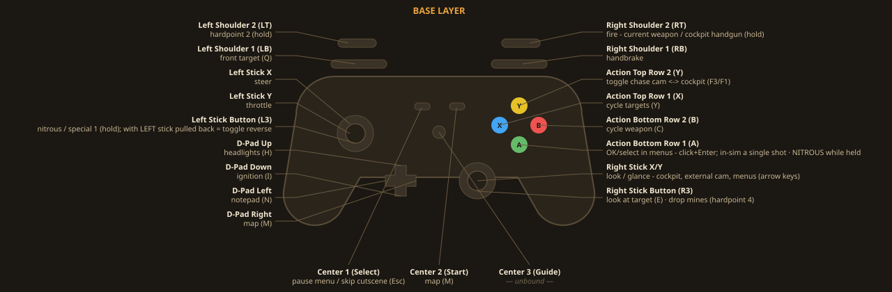
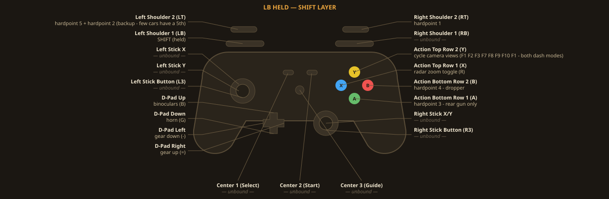

# i76-everywhere: Interstate '76 at 120 fps with the 1997 physics

<!-- ===================== HYPE VIDEO PLACEHOLDER (video lane: replace this block) =====================
     1. Upload the video to a GitHub issue / release and paste the user-attachments URL on its own line below;
        GitHub renders a bare https://github.com/user-attachments/assets/<id> link as an inline player.
        (A repo-relative .mp4 path does NOT play inline on GitHub; a <video> tag only works with that URL.)
     2. Animated preview fallback (shows everywhere, links to YouTube):
        
     3. Plain YouTube link line:
        **[Watch the video on YouTube](https://www.youtube.com/watch?v=VIDEO_ID)** (2 min)
     Uncomment what you use; delete this comment.
     ===================== END HYPE VIDEO PLACEHOLDER ===================== -->

**What this is:** a free patch kit for your own GOG copy of Interstate '76 (Gold / Arsenal). The 1997 game still runs;
we fix and extend it around the original code, so saves, add-on maps and multiplayer keep working.
Nothing of the game is in this repo or the kit, and every file the kit changes is kept and restorable.

**[Download the Patch Kit v0.8.0 (Windows 10/11, Gold and Nitro Pack, 5.8 MB)](https://github.com/therealjkvalentine/i76-everywhere/releases/tag/v0.8.0)**
· [release notes](docs/release/RELEASE-NOTES-v0.8.0.md) · [report a problem](https://github.com/therealjkvalentine/i76-everywhere/issues) · Mac and Steam Deck: [below](#play-it-on-a-modern-pc-mac-or-steam-deck)

## What you get

| | GOG as shipped | with the kit |
|---|---|---|
| frame rate | 20 fps | **120 fps**, the car still simulated 24 times a second as on a 1997 Pentium 166 (jumps and AI as tuned) |
| draw distance | 600 m | **1.8 km**; **2.3 km** fading out at the far edge in the preview launcher |
| terrain | hills pop as you approach | morphs in, smooth shading (preview launcher) |
| picture | 4:3, 90° field of view | your monitor's shape (21:9 / 16:9 / 16:10): you see MORE of the world, not a stretched picture (horizontal field of view about 122° on 21:9, 106° on 16:9; `I76_FOV` changes it), 2x supersampled, AA 4x (both configurable) |
| rear-view mirror | cars on a plain sky | road and terrain, 300 m (1 km in the preview) |
| menus | pointer misses with a modern mouse | pointer lands where you click; typing on the save screen; Enter / Y / N on popups |
| Windows 11 (build 26100.9711) | start-up crashes | dgVoodoo 2.87.5 + our winmm fix: 0 crashes in 40 boots (28 in 59 before) |

Also in this repo, experimental and not yet in the kit: **LAN play with AI cars dropping into empty seats** and host
migration, a **two-player co-op campaign**, Nitro Pack **"Arena Drop-In + AI"** and **"Co-Op"** game types, **wheel force
feedback with a tuning page** in your browser, **head look** (opentrack), and a **Mac (Wine)** build. Details:
[the release notes](docs/release/RELEASE-NOTES-v0.7.md#in-the-repo-not-in-the-kit-yet-experimental).

## Install the Patch Kit (three steps)

1. Find your GOG game folder (Galaxy: the settings icon next to PLAY > *Manage installation* > *Show folder*; the folder
   with `i76.exe`).
2. Download the zip above, right-click > *Properties* > tick *Unblock*, then *Extract All* **into** that folder, so
   `PLAY.bat` sits next to `i76.exe`.
3. Double-click **`PLAY.bat`** (first run: ten seconds of setup that lists every file it changes). `PLAY-PREVIEW.bat` is
   the 2.3 km experimental look. `UNINSTALL-i76e.bat` undoes everything.

To change settings (render scale, antialiasing, field of view, draw distance, force feedback, sound, co-op ...), double-click
**`SETTINGS.bat`**: it opens `i76-settings.txt` in Notepad, one setting per line with its allowed values. The full guide is
`README-PATCH-KIT.md` in the zip ([tools/patch-kit/README.md](tools/patch-kit/README.md)).

## Problems and feedback

Everything goes through **[GitHub Issues](https://github.com/therealjkvalentine/i76-everywhere/issues/new/choose)**: pick
*Something went wrong*, *Network / LAN game problem* or *Idea or request*, and the form asks for what we need. Ideas you want
others to vote on go to [Discussions > Ideas](https://github.com/therealjkvalentine/i76-everywhere/discussions/categories/ideas),
questions to [Discussions > Q&A](https://github.com/therealjkvalentine/i76-everywhere/discussions/categories/q-a). Attach these
three files from the game folder (the one with `i76.exe`; every log's first line repeats this request):

| file | what it says |
|---|---|
| `mciproxy.log` | what our engine fixes did, the display and pointer mapping, any `CRASH:` line |
| `play-i76.log` | what the launcher switched on (preset, settings, render size, head look, force feedback) |
| `i76-settings.txt` | your settings |

Plus `_i76e\setup.log` if the first-run setup failed. The logs contain no personal data except your Windows user name in folder
paths (they also name your monitor size and controller model). For a network game, attach the files from every machine.

---

## Get involved

Three ways, pick any:

1. **Play it and tell me.** Try the kit on your machine and monitor, report what breaks in an [issue](#problems-and-feedback) (`mciproxy.log` from the game folder says most of it), and if you make videos or write about old games, I'm happy to send a ready-to-run build or talk through how it was done.
2. **Build it with me.** The next big steps need more hands: HD art and a renderer that can show it, more platforms and peripherals (wheels, pads, motion rigs), new missions and arenas, and plain code review. Issues and pull requests are open; the records in `docs/records/` show how every change was measured.
3. **Buy my family a dinner.** This took hundreds of hours, a lot of tokens, and every computer in the house running tests overnight, Macs and Steam Deck included, while my family waited to use them. If it gave you back a game you love: [buymeacoffee.com/therealjkvalentine](https://buymeacoffee.com/therealjkvalentine).

## About this repository

**Interstate '76 (GOG Gold, 1997) running well on everything: Apple Silicon Macs, Steam Deck,
and modern Windows — plus a full save editor and the reverse-engineered file formats.**

This repo ships **no copyrighted game files**. You bring your own GOG copy; everything here is
scripts, source, and documentation. Downloaded/copyrighted material lives in a local, gitignored
`game-data/` folder.

## Play it on a modern PC, Mac or Steam Deck

You need **[Interstate '76 Arsenal from GOG](https://www.gog.com/en/game/interstate76)** (the game plus the
Nitro Pack). It is not sold on Steam. CD copies are untested. Download GOG's **offline backup installer**
(`setup_interstate76_*.exe`: gog.com/account > Interstate '76 > More > Download offline backup game installers) and
leave it in your Downloads folder. Everything below works from that file; nothing here contains game data.

| platform | what you get | state |
|---|---|---|
| **Windows 10/11** | 120 fps with the game's timing kept right, longer draw distance, music that continues, controller and wheel layouts; widescreen opt-in | played daily by the owner; the installer has not yet been run end to end on a freshly installed PC |
| **Mac, Apple Silicon** | Glide renderer through Wine, about 100-120 fps, fullscreen, music | beta: one manual step (the Wine wrapper) before the scripts |
| **Steam Deck** | Glide through dgVoodoo/Vulkan, controller layout, rumble | pre-release **[Deck Kit v0.1.0](https://github.com/therealjkvalentine/i76-everywhere/releases/tag/deck-v0.1.0)**: not yet community tested, expect rough edges; tested end to end in a fresh folder on one Deck |

**Windows**
1. Get this repo (green *Code* button > *Download ZIP*, then unzip).
2. Double-click **`INSTALL.bat`**. It installs the game from your GOG file to `C:\GOG Games\Interstate 76`, checks it is
   a build it knows, downloads dgVoodoo and AutoHotkey, and adds the fixes.
3. Start the game from the new desktop shortcut.

Options (original 1997 keys, 20 fps stock, widescreen, another folder) and undoing it: [INSTALL.md](INSTALL.md).

**Mac (Apple Silicon)**
1. Build the Wine wrapper with the GOG game inside it: [docs/MAC-BUILD.md](docs/MAC-BUILD.md), "The working recipe".
   This is the manual step.
2. Double-click **`mac-install.command`**. It sets up DxWnd, the music, the controls and the launcher.
3. Run **`setup-mac-glide.sh`** in Terminal for the 120 fps Glide renderer
   ([tools/openglide-hd/MAC-BUILD.md](tools/openglide-hd/MAC-BUILD.md) section 11). It needs `brew install mingw-w64`.
4. Open **`~/Applications/Sikarugir/Interstate 76 Gold.app`**. The first start asks for microphone access. The game never
   records anything; macOS asks any app that opens an audio output unit on some Macs (section 12 of the same file).

**Steam Deck** ([Deck Kit v0.1.0 pre-release](https://github.com/therealjkvalentine/i76-everywhere/releases/tag/deck-v0.1.0): not yet community tested; Claude Code pointed at this repository can usually diagnose problems, and we would love your feedback in a GitHub issue)
1. Put the GOG installer in `~/Downloads`, and unzip the Deck Kit there; then run `bash i76-deck-kit.sh install --gog ~/Downloads/setup_interstate76_2.1.0.17.exe` in Konsole (steps: [deck/kit/README.md](deck/kit/README.md)).
   The older route below still works:
2. In Desktop Mode run [`deck/Install-I76.desktop`](deck/Install-I76.desktop) (or the one-liner in
   [docs/STEAMDECK.md](docs/STEAMDECK.md)).
3. Back in Game Mode, start it from your library. Details and the controller layout: [docs/STEAMDECK.md](docs/STEAMDECK.md).

**Playing together at home:** IPX through IPXWrapper ([docs/MULTIPLAYER.md](docs/MULTIPLAYER.md)). A Windows PC hosted
and a Mac joined the same arena on 2026-10-06. The game's INTERNET option does not work between machines on one home
network. Online, the community plays Nitro Pack through a community lobby; the same page says how.
**Co-op campaign (experimental):** two players through the story missions, the host as the hero and the buddy in
their own car, sharing the enemies, radio and progress: [docs/COOP.md](docs/COOP.md).

**If it goes wrong**
- Hangs on "PLEASE STAND BY": you are connected over Remote Desktop. Play at the machine itself.
- A controller or wheel does nothing: `python3 tools/lint-input-map.py "<game folder>"`, then
  [docs/CONTROLS.md](docs/CONTROLS.md).
- Anything else: [docs/VERIFIED-FIXES.md](docs/VERIFIED-FIXES.md) (symptom > cause > fix), then open an issue.

## Start here

| You want to… | Go to |
|---|---|
| **Play on a Mac** (Apple Silicon) | [docs/MAC-BUILD.md](docs/MAC-BUILD.md) (the Wine wrapper and DxWnd), then [tools/openglide-hd/MAC-BUILD.md](tools/openglide-hd/MAC-BUILD.md) — since 2026-10-04 the daily Mac build is the Glide renderer (OpenGLide) under DxWnd, ~100-120 fps. The software renderer (20 fps) remains the fallback |
| **Play on a Steam Deck** | [docs/STEAMDECK.md](docs/STEAMDECK.md) — the pretty Glide path (dgVoodoo→Vulkan) + force feedback |
| **Play on Windows** | [docs/WINDOWS-PLAYBOOK.md](docs/WINDOWS-PLAYBOOK.md) — max graphics, FFB, frame-gen. Install: [INSTALL.md](INSTALL.md) (120 fps by default; widescreen with `-Preset best-wide`, opt-in) |
| **Sit down and play: the controls** | [docs/CONTROLS.md](docs/CONTROLS.md) — one page for all keyboard, keyboard and mouse, gamepad, and wheel and stick (HOWAS): the keys, how to turn each on, what to do when it misbehaves |
| **Edit your saves** (no install) | **[Open the save editor in your browser →](https://therealjkvalentine.github.io/i76-everywhere/i76-save-editor.html)** — drag a save in, download it back out. Details: [the save editor](#the-save-editor) |
| **A printable key sheet** | [docs/Interstate76-Controls-Quick-Reference.pdf](docs/Interstate76-Controls-Quick-Reference.pdf): five pages (keyboard and mouse, gamepad, wheel, flight stick, 1997 keys vs ours; the pad, wheel and stick drawn with every button labelled), generated from the shipped map by [tools/controls-sheet](tools/controls-sheet/README.md). **This project installs its own WASD-style control map, not the 1997 layout**; `-Controls stock` keeps the original keys ([docs/CONTROLS.md](docs/CONTROLS.md)) |
| **Understand the file formats** | [i76-save-editor.py](i76-save-editor.py) docstring (save format) + [docs/HD-TEXTURES-RESEARCH.md](docs/HD-TEXTURES-RESEARCH.md) (ZFS/VQM/M16) |
| **Know what's already settled** | [docs/README.md](docs/README.md) — the doc map: what works, what's a parked dead end. **Read before re-chasing anything** |
| **Every fix, one table** | [docs/VERIFIED-FIXES.md](docs/VERIFIED-FIXES.md) — symptom → root cause → fix, all verified in play |
| **The 60 fps lab and its test harness** | [lab/](lab/README.md) — public snapshot of <lab> (2026-10-03): the engine reference, frame-rate work, autotest scripts |
| **The reverse-engineering map** | [re/](re/README.md) — public snapshot of <re-archive> (2026-10-03): engine architecture, subsystem specs, file formats and parsers |

## Everything this adds

It is not only graphics. **[docs/ENHANCEMENTS.md](docs/ENHANCEMENTS.md)** is the one catalogue of every enhancement
in this repo, each with how to turn it on and how far it has been proven:

- **Controls**: the gamepad layout and its AutoHotkey shift layer, a CH Fighterstick layer, a force-feedback wheel,
  mouse buttons, the Steam Deck layout, an `input.map` lint, and a printable key sheet generated from the map.
- **Force feedback and haptics**: the game's own effects on a modern wheel, a custom wheel force model, bass
  shakers, pad rumble, and a telemetry feed for motion rigs.
- **Head tracking**: opentrack driving the in-game view.
- **Frame rate and simulation fixes**: 60 and 120 fps with the physics, AI and effects behaving as at 20.
- **Graphics**: widescreen (Hor+), supersampling and antialiasing, draw distance and detail distances,
  frame generation, menu art tools.
- **Audio**: the CD soundtrack restored in missions, and the cutscene-music fix.
- **Bug fixes**, a **trainer**, the **save editor**, modding and reverse-engineering tools, and the
  **Mac / Steam Deck / Windows** install and packaging scripts.

Many items are opt-in or sandbox-only; the catalogue's evidence column says which.

## Playing at 60 / 120 fps

The game is 20 fps as GOG ships it. The music-fix proxy (`music-fix/Strlkup.dll`) carries an
opt-in switch set that makes it play well above that; `PLAY-i76.ps1 -Preset <name>` applies a
named set from [`presets/`](presets/) to the game process only (`-Preset ?` lists them,
`-DryRun` shows what the game would get without starting it; `LAUNCHER.ps1` has the same
drop-down). The default, `stock`, sets nothing.

| preset | what it sets | status |
|---|---|---|
| `stock` | nothing | [verified in play] the game as GOG ships it (the daily driver until 2026-10-03) |
| `smooth-60` | `I76_HIRES_CLOCK=1 I76_FIXED_STEP=24 I76_FRAMERATE_FIXES=1 I76_ENGINE_DT_FIX=1 I76_RENDER_INTERP=1` | [measured, sandbox] capture 014; [console-verified 2026-10-02, sandbox] n = 1 |
| `smooth-60-bugfixes` | smooth-60 + `I76_FIX_HEALTH_PCT=1 I76_FIX_LABEL_TABLE=1` | [measured, sandbox]; on in the 2026-10-02 console session |
| `smooth-120` | smooth-60-bugfixes + `I76_GLIDE_REFRESH=120` | [measured, sandbox] 120.1 fps; the same switches plus the 1800 m far clip were played by the owner at 120 on 2026-10-02 (as `best-120`) |
| `best-120` | smooth-120 + `I76_FAR_CLIP=1800`; `I76_COLL_DEDUPE=0`, `I76_AI_ROLL_HOLD=0` (count only, not measured) | [console-verified 2026-10-02, sandbox] by the owner; [measured] 120 fps through the trip menus; the preset of the daily driver built 2026-10-03 |
| `best-wide` | best-120 + widescreen `I76_ASPECT` + terrain, texture, object, shadow, road, bush and mirror detail farther out | [owner-played 2026-10-03, sandbox]; the daily driver's `PLAY.bat` since 2026-10-03 (promotion 2). Needs a widescreen dgVoodoo conf; played only on 3440x1440. Menus and cutscenes stay stretched |
| `lab-all` | smooth-60-bugfixes + `I76_FAR_CLIP=1800 I76_TELEMETRY=1` (TEST-FRAMERATE mode 5) | [console-verified 2026-10-02, sandbox] n = 1 |

**Widescreen:** `best-wide` widens the camera to the display's shape instead of stretching a 4:3 view. The
game still renders 640x480, so dgVoodoo must present it stretched to that shape. `setup-windows.ps1 -Preset
best-wide` writes that conf and this display's width x height into the installed preset
([INSTALL.md](INSTALL.md#presets-best-120-stock-and-best-wide)). The menus, cutscenes and in-mission text stay
stretched ([docs/ENHANCEMENTS.md](docs/ENHANCEMENTS.md#5-graphics) says why). The other presets in
[`presets/`](presets/) (`exp-*`, `framegen-90`) are experiments.

**State on 2026-10-03:** a new daily driver was built by `tools\Make-Daily-Driver.ps1` with `best-120` as its
preset (since promotion 2 that day, `best-wide`; `PLAY-16x10.bat` keeps `best-120`) ([docs/records/NEW-DAILY-DRIVER-RECIPE.md](docs/records/NEW-DAILY-DRIVER-RECIPE.md),
[docs/records/STATUS-2026-10-02.md](docs/records/STATUS-2026-10-02.md) last section). The other presets remain experimental
until the A/B in [docs/RELEASE-PLAN.md](docs/RELEASE-PLAN.md) section 7 is done. 120 fps is the ceiling of every
renderer tested ([docs/records/RENDERER-ALTERNATIVES.md](docs/records/RENDERER-ALTERNATIVES.md) section 11). Two things have to
be true for a preset to do anything: the game folder's `Strlkup.dll` must be the current music-fix build
(the launcher compares it and tells you to run `setup-windows.ps1` if not; it copies nothing), and
GOG's `I76PATCH.DLL` (the 20 fps cap) must be renamed out of the way (the launcher only says so;
`setup-windows.ps1` does it).

**Installing on Windows from your own GOG copy** ([INSTALL.md](INSTALL.md)): since 2026-10-03 `INSTALL.bat`
(`Setup-From-GOG.ps1` -> `install.ps1` -> `setup-windows.ps1`) sets a fresh install up like that daily driver:
the daily-driver `dgVoodoo.conf`, the music-fix proxy, `u32x.dll`, `I76PATCH.DLL` renamed, and `PLAY-i76.bat`
starting `-Preset best-120`, with `PLAY-stock.bat` beside it. `-Preset stock` on any of the three scripts
installs the earlier 20 fps recipe instead. Evidence: the apply step was run on an unpacked copy of GOG's
2.1.0.17 installer and checked by file listing, md5, the `input.map` lint and the launcher's `-DryRun`;
**the game was not started from it**, and `best-120` has not been run on the exe that installer gives
(`9a232dcc`; the gates ran on `60abf7bc`). Since 2026-10-03 the installer deploys the daily driver's u32x build
(`u32x/u32x_full.dll`; source in [u32x/](u32x/README.md); the daily driver runs `054fb411`, the committed build is `696577dc` since the evening of 2026-10-03, sandbox-gated); `-U32xDll u32x\u32x.dll` gives the minimal `a5927cea`. Details and the full not-tested list:
[INSTALL.md, Evidence](INSTALL.md#evidence-what-was-tested).
Per-switch evidence: [music-fix/README.md](music-fix/README.md); the 120 Hz analysis:
[docs/records/FPS-120.md](docs/records/FPS-120.md).

**Multiplayer is untested with any preset other than `stock`** (backlog P3-20): the fixed step and the
interpolation change when the simulation advances, and nobody has run two machines against each other with
them on. Play online on `stock` until someone has. (2026-10-03: the proxy's `I76_MULTI_INSTANCE=1` lets two
copies run on one PC, and two lab copies ran side by side; a multiplayer session between them was **not**
achieved: both copies need UDP port 21157, and the internet transport wants a game server.)

## Open work

The roadmap is on GitHub: **[ROADMAP.md](ROADMAP.md)** (three tiers, milestones, how to vote), the
[project board](https://github.com/therealjkvalentine/i76-everywhere/projects), the
[issues](https://github.com/therealjkvalentine/i76-everywhere/issues) and
[Discussions > Ideas](https://github.com/therealjkvalentine/i76-everywhere/discussions/categories/ideas). How it is run:
[docs/PROCESS.md](docs/PROCESS.md). Top five right now:

1. [#1](https://github.com/therealjkvalentine/i76-everywhere/issues/1) the host's mission stalls while a joiner is in a co-op game
2. [#2](https://github.com/therealjkvalentine/i76-everywhere/issues/2) Nitro at 1920x1080: odd first frame and an enlarged HUD
3. [#7](https://github.com/therealjkvalentine/i76-everywhere/issues/7) Mac: Nitro still capped at 24 fps
4. [#8](https://github.com/therealjkvalentine/i76-everywhere/issues/8) Mac Kit: the first build by a person
5. [#11](https://github.com/therealjkvalentine/i76-everywhere/issues/11) internet play through a hosted relay

## The gamepad layout

**For Windows, the current layout is page 2 of [the printable key sheet](docs/Interstate76-Controls-Quick-Reference.pdf)**, generated
from the shipped map and the layer script. The two pictures below were drawn from a Mac game folder's map
and show native button bindings the shipped Windows map does not have.

The full controller scheme — native `input.map` bindings plus the AutoHotkey/XInput
layer (shift layer, look-back fire, rumble). These render from the **live configs**
via [tools/pad-diagram.py](tools/pad-diagram.py); regenerate after any binding change
(`open-pad-diagram.command` also gives an interactive HTML with the mouse/keyboard
tables) — never hand-edit them.

Design doctrine: [docs/CONTROL-DOCTRINE.md](docs/CONTROL-DOCTRINE.md) ·
Gamepad reference: [docs/GAMEPAD-PC-MAC.md](docs/GAMEPAD-PC-MAC.md)

## The save editor

A single self-contained web page styled after the game's garage paperwork.
**Zero-install:** [use it right now in any browser](https://therealjkvalentine.github.io/i76-everywhere/i76-save-editor.html)
— drag a save file in, edit, download it back out (nothing is uploaded; it all runs locally in the page).

- `./i76-save-editor.command` (Mac) — opens the editor with your saves auto-loaded and
  **writes edits straight back** (timestamped backups on every write; deletes are recoverable)
- `i76-save-editor.html` — the same page anywhere (Windows/Deck browser): drag saves in,
  download edits out
- `i76-save-editor.py` — the same parser as a terminal tool

What it edits: equipped parts (any weapon on any mount — off-spec swaps clearly marked),
armor (the DEFENSE panel numbers), every part's state (car/van/bench/salvage), condition, part
swaps with **measured DPS + range** on every weapon (data: Local Ditch), scene selection
("Scene № on a diner check"), save-as-slot, delete/restore. The save format follows the
game's own writer (`.py` docstring; `docs/SAVE-FORMAT-GAPS.md`); both editors round-trip every
sample save byte for byte and stay in lockstep (`python -m pytest tests/`). Status and the
open in-game checks: `docs/records/SAVE-EDITOR-STATUS-2026-10-02.md`.

## Highlights under the hood

- **Cutscene-music fix** ([smack-music-fix/](smack-music-fix/)): a proxy `SMACKW32.DLL` that
  recreates the 1997 CD-drive behavior (music stops when a movie starts) — fixes a GOG bug
  the community called unfixable. Ordinal-exact export forwarding; works on Mac and Windows.
- **20 FPS as shipped** everywhere by default (stock, the engine's behaviour changes with the frame rate; the
  60 / 120 fps switch set above is what corrects that): DxWnd delay on Mac, dgVoodoo `FPSLimit` on the Deck,
  GOG's `I76PATCH.DLL` on Windows. (Corrected 2026-10-03: this said dgVoodoo `FPSLimit` on Windows. The lab's
  "FPSLimit is ignored" result is void, measured while dgVoodoo was rejecting the sandbox conf; whether
  `FPSLimit` caps on Windows has not been re-measured.) Since 2026-10-03 the Windows installer is the exception:
  it sets up `best-120` unless run with `-Preset stock` ([INSTALL.md](INSTALL.md)).
- **The `.M16` hardware-texture format cracked** (round-trip encoder in
  [tools/i76img.py](tools/i76img.py)) — the RE prize from an enhanced-texture-pack
  experiment that was ultimately **retired** (marginal in-game gain; palette-indexed
  tiles break on night missions). Full writeup: [docs/HD-TEXTURES-RESEARCH.md](docs/HD-TEXTURES-RESEARCH.md).
- **The Voodoo path** (Glide→dgVoodoo→DXVK→MoltenVK→Metal) works but is **parked on Mac** —
  MoltenVK can't persist compiled pipelines. [docs/VOODOO-PARKED.md](docs/VOODOO-PARKED.md)
  has the exact announcement that would revive it.

## Provenance

Grown from [mac-gaming-ports](https://github.com/therealjkvalentine/mac-gaming-ports)'
`games/interstate-76/`, promoted to its own repo. Credits: UCyborg's AiO patch, dgVoodoo
(Dege), DxWnd (gho), Local Ditch Gaming (weapon measurements: Greg Schwartz / Zaphod-AVA),
the Open76 and Roanish/i76 reimplementation projects, and That Tony's format work.
